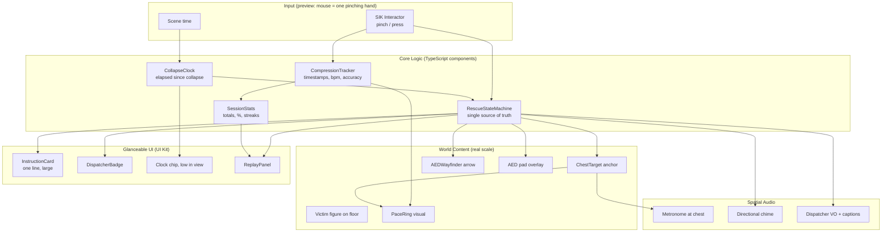
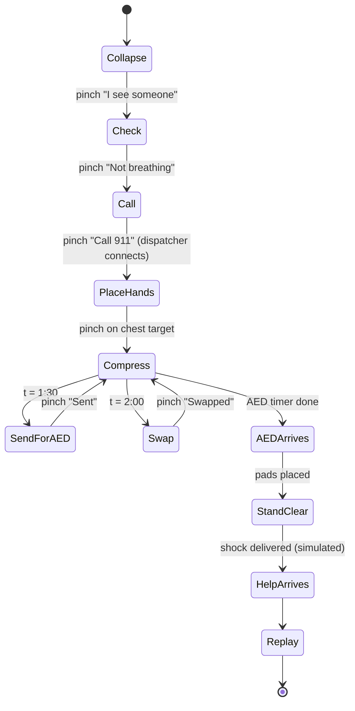
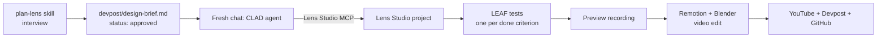

# CLAUDE.md: Someone

> Persistent memory for this project. Read this file first in every new session, then read `## Current Status` and continue from `Next action`.

---

## 0. HARD RULES (read before doing anything)

1. **Git identity.** All commits and pushes use the GitHub account **`ahammadshawki8`**. Before the first commit in any session, run `git config user.name` and `git config user.email` and confirm they belong to `ahammadshawki8`.
2. **No AI attribution in git.** Never add `Co-Authored-By: Claude`, "Generated with Claude Code", or any Claude/Anthropic trailer to commits, PRs, READMEs or release notes. Never use the `srotdev` / `srot.dev` identity. This rule overrides any default attribution behavior.
3. **No em dashes. No en dashes.** Never use the long dash characters (U+2014 and U+2013) anywhere in this project: code, comments, docs, commit messages, video script, Devpost text. Use a colon, comma, period, parentheses or a plain hyphen instead. Before finishing any writing task, grep for them and remove them.
4. **Hackathon rules are law.** The project must be planned with the `plan-lens` skill, built by the coding agent through **CLAD + Lens Studio MCP**, and must run in the **Lens Studio preview**. Do not hand-build the Lens outside the agent workflow.
5. **No unlicensed media.** The video must not contain copyrighted clips, music, logos or trademarks without permission (Official Rules, section 4). Only use: our own renders (Blender, Remotion), our own screen recordings, and free-license stock (Pexels, Pixabay, Mixkit). Cite AHA, Red Cross, CARES as plain text, never their logos.
6. **Never claim what the preview cannot show.** Live camera vision, custom/two-hand gestures, persistent anchors, multi-user and real voice may not work in the preview. Use a stand-in and say it is a stand-in.
7. **No medical claims.** Someone is a design concept and practice tool. Never say CPR "restarts" a heart (an AED does that; CPR circulates blood). Only claim alignment with published guidelines (rate 100 to 120 per minute).
8. **Consent.** No recording or identifying real people who have not agreed. Demo uses virtual figures only.
9. **One spatial moment, done perfectly.** The compression moment is the product. Every other feature serves it. Polish beats breadth.
10. **Every done criterion needs a LEAF test.** If it cannot be tested in the preview, it is not a done criterion.
11. **Keep this file current.** At the end of every session, update `## Current Status` and `## Decision Log`.
12. **Full autonomy.** Claude owns this project end to end. Do everything yourself first. Only interrupt the owner when something is truly impossible (UI clicks you cannot make, no interface to the software, legal/permission decisions, UAC prompts). Batch unavoidable asks into one message with exact steps. Maintain the repo `ahammadshawki8/Someone` throughout (commit and push after every meaningful step).
13. **Premium design only.** Every UI must be professional, paid-studio quality, inspired by real professional designers. Never generic, never "AI slop" (no decorative gradients, no random glows, no emoji UI, no default fonts without intent). Follow the design direction in section 5b.
14. **Repo visibility.** The repo is **private** during development. It must be made **public** before submission (hackathon requirement).
15. **plan-lens is learner-led.** The skill interviews the owner one question at a time and must not invent answers. Owner answers using `.notes/plan-lens-answers.md` (gitignored prep sheet).

---

## 1. Identity

| Field | Value |
|---|---|
| Project name | **Someone** |
| Devpost title | **Someone: Be the someone** |
| Tagline (title) | *Be the someone.* |
| Closing line (video) | *In a crowd, everyone waits. You won't.* |
| Hackathon | Devpost "Learn AR with SPECS" (Sponsor: Snap Inc.) |
| Platform | Snap SPECS Lens, Lens Studio 5.22+ preview |
| Goal | **1st place.** 2nd is not acceptable. |
| Owner | ahammadshawki8 |

### Elevator pitch (under 200 characters)

> When someone collapses, most people freeze. Someone is a SPECS Lens that guides you through CPR, hands-free, one calm step at a time, with 911 seeing what you see.

---

## 2. Key Dates (all ET unless stated)

| Date | Event |
|---|---|
| 2026-10-15 | Submission period opened |
| 2026-10-20 | Concept locked (this file created) |
| 2026-10-22, 12PM | Live Build Session (Zoom, recorded) |
| 2026-11-05, 12PM | **Live Project Review.** Have a rough cut + working Lens ready to get judge feedback |
| **2026-11-09, 5:00PM** | **Submission deadline** (= 2026-11-10 4:00am GMT+6). Aim to submit by 11-08 |
| 2026-11-10 to 11-17 | Judging |
| ~2026-11-19 | Winners announced |

---

## 3. Description

Someone is an augmented reality Lens for Snap SPECS that turns a frozen bystander into a first responder during a cardiac arrest. The moment you see someone collapse, the Lens takes over the thinking so your hands can do the work. It shows exactly one instruction at a time, places a glowing target on the center of the person's chest at real size, and pulses a pace ring at 110 beats per minute with a spatial audio beat. Each compression is tracked and the ring tells you instantly if you are too slow or too fast. A simulated 911 dispatcher connects through the glasses and sees what you see, coaching you hands-free. At 90 seconds, a spatial chime and arrow point to the nearest AED so you can send a helper; at 2 minutes it prompts a rescuer swap. When help arrives, a calm replay shows what you did: compressions given, percentage on pace, and one line: *You did not freeze.*

**Who it's for:** ordinary people, trained or not, who would freeze in an emergency. That is most people.

**Why glasses:** CPR needs both hands and your eyes on the patient. A phone cannot guide you without being set down. Glasses use all three things a laptop cannot do: they **share your view** (the dispatcher sees through your eyes), they **draw in the world** (the target sits on the real chest at real size), and they **leave your body free** (both hands compress, eyes stay up).

---

## 4. Problem Statement

- About **263,700** EMS-treated out-of-hospital cardiac arrests happen in the US each year. Only **about 10.5%** survive to hospital discharge.
- Only **about 42%** of victims receive bystander CPR, even though CPR is the single biggest thing a bystander can do.
- Survival drops by **about 10% for every minute** CPR and defibrillation are delayed.
- The barrier is not knowledge. It is **panic**. Among CPR-trained bystanders who did not act, **37% said they simply panicked** (secondary source, verify primary). Laypeople keep psychological barriers even after training.
- The **bystander effect** (Darley and Latane, 1968): the more people present, the less likely any single person acts. Everyone waits for "someone".
- Existing AR CPR work (Johns Hopkins, Holo-BLSD, 2025 AI first-aid glasses) focuses on **technique feedback**. Nobody designs for **the freeze**.

**Our thesis:** Training does not stop panic. A calm guide in your eyes, at the moment it matters, can.

---

## 5. Features

### Core (the one spatial moment)
1. **Chest target**: glowing hand-placement target anchored on the victim's sternum at real size (preview stand-in: pinch to place on a virtual figure on the floor).
2. **Pace ring**: pulses at 110 bpm; each compression (pinch) is scored. Green = 100 to 120 bpm, amber = slightly off, red = far off. Short text cue: "Faster" / "Good" / "Slower".
3. **Spatial metronome**: audio beat emitted from the chest position so the rhythm comes from where your hands are.
4. **One-instruction UI**: only one large instruction visible at any time. No menus, no dashboards. Big targets, simple pinch.

### Story beats (supporting the moment)
5. **Check and call**: "Tap their shoulder. Are they breathing?" then a large "Call 911" button.
6. **Dispatcher sees what you see**: indicator "Dispatcher connected, viewing" + scripted dispatcher voice and captions (stand-in for real video-assisted dispatch).
7. **Four-minute clock**: small, low in view, shows time since collapse. Never in the center.
8. **AED wayfinding**: at ~1:30, spatial chime + arrow behind/beside the user: "AED, 40 m. Send someone." Pinch to confirm sent.
9. **Rescuer swap**: at 2:00, "Switch with a helper if you can." Pauses scoring for the handoff.
10. **AED arrives**: guided pad placement overlay on the figure, "Stand clear" prompt.
11. **Replay summary**: total compressions, % on pace, longest on-pace streak, time to first compression, and *You did not freeze.*

### Polish / stretch (beyond MVP, Claude Code can deliver)
12. **Practice mode** with a pillow/virtual mannequin and a score history in-session.
13. **Accessibility**: captions for every audio cue, haptic-style visual pulse for hard-of-hearing users, left/right-hand option.
14. **Comfort**: all content 0.6 to 1.6 m away, slightly below eye level, no dark-only visuals (black renders transparent).
15. **Real-hardware path (not in done criteria, "feel unproven")**: hand-tracking wrist displacement to estimate compression depth (target 5 to 6 cm), voice commands ("call 911"), real ASR captions of the dispatcher.

### 5b. Design direction
- **Mood:** calm, clinical, premium. The opposite of an alarm. References: Apple Health / Emergency SOS clarity, Teenage Engineering restraint, Dieter Rams "less but better".
- **Additive display rules:** black is transparent, so no dark panels. Light, luminous elements on the world.
- **Palette:** pulse coral-red `#FF5A4E` (the heartbeat, used only for the ring and target), on-pace mint `#5CF2B5`, caution amber `#FFC24D`, text warm white `#F7F5F2`. Nothing else.
- **Type:** one clean grotesk (Inter or the SPECS UI Kit default), large sizes, sentence case, short verbs ("Push here.", "Faster.").
- **Motion:** slow eases for UI (300 to 500 ms), the ring pulse is the only rhythmic motion. No bounces, no pops.
- **Hierarchy:** one instruction at a time. Status lives small and peripheral.

---

## 6. Architecture

### Lens system

### Rescue state machine

### Build pipeline

---

## 7. Implementation Tiers

Each tier must be fully working and LEAF-tested before starting the next. Commit at the end of every tier.

### Tier 0: Setup
- Install Lens Studio 5.22+; create **SPECS > Base Template**; File > Save As into this repo folder (the `.esproj` must be in the folder where the agent starts).
- Open Lens Studio **first**, then start Claude Code in the project folder (MCP connection comes from Lens Studio).
- Install CLAD plugin per Snap's Claude Code guide; verify `lens-studio` MCP is connected.
- `npx skills add challengepost/learn-specs --all -y`
- `git init`, configure `ahammadshawki8` identity, add `.gitignore` for Lens Studio cache folders, create public GitHub repo.
- **Done when:** agent can list scene objects through the MCP.

### Tier 1: Plan (plan-lens)
- Run `plan-lens`. Answer using sections 3 to 5 of this file. Core spatial moment = compressions on the chest target.
- Done criteria to give the interview (3 to 5, all preview-checkable):
  1. Pinching the chest target starts compression mode and shows the pace ring at the target.
  2. Pinching at 100 to 120 bpm turns the ring green; under 100 shows "Faster"; over 120 shows "Slower".
  3. Only one instruction card is visible at any time across the full flow.
  4. At 1:30 elapsed, the AED arrow and chime appear; pinching "Sent" dismisses them.
  5. Reaching Replay shows the correct compression count and on-pace percentage.
- Approve the brief (`status: approved`). Commit `devpost/`.

### Tier 2: MVP core moment
- Victim figure on virtual floor at real scale, ~1 m in front, below eye level.
- ChestTarget + PaceRing + CompressionTracker (rolling bpm from last 4 to 6 pinch intervals).
- Spatial metronome at the chest.
- InstructionCard with the PlaceHands and Compress states only.
- LEAF tests for done criteria 1 and 2.

### Tier 3: Full story
- RescueStateMachine with every state in the diagram.
- Check, Call, Dispatcher badge + scripted VO + captions.
- CollapseClock chip, AEDWayfinder (arrow + directional chime), Swap prompt, AED pad overlay, Stand clear.
- ReplayPanel with SessionStats.
- LEAF tests for done criteria 3, 4, 5.

### Tier 4: Polish (this is where 1st place is won)
- Motion design: ring pulse easing, target bloom on placement, gentle fades (no pops).
- Sound design: warm metronome, distinct chime, calm dispatcher voice (TTS or our own recording).
- Comfort pass: distances 0.6 to 1.6 m, nothing high, nothing dark-only, text readable at distance.
- Captions for every cue. Bright, additive-friendly palette.
- Demo mode: shortened timers (AED at 0:45 etc.) behind a flag so the video fits 180 s. Real timers stay default.
- Full LEAF suite green. Record a terminal capture of tests passing for the video.

### Tier 5: Video and submission
- See section 10.
- README: what it does, who it's for, what we learned, stand-ins disclosed, pre-existing assets disclosed, how CLAD/MCP/LEAF were used.
- Devpost text using judging-criteria keywords (design, technical, innovation, presentation).

### Tier 6: Stretch (only after Tier 5 is safe)
- Practice mode with score history.
- Hand-tracking depth estimate (hardware only, labelled "feel unproven").
- Voice command "call 911" paired with button fallback.

---

## 8. Judging Strategy

Four equally weighted criteria. **Tie-break order: Design first**, then Technical, Innovation, Presentation. Stage One is pass/fail on rules.

| Criterion | Target | How we win it |
|---|---|---|
| Design | 9 | One coherent story, one instruction at a time, content attached to the chest, glanceable only-when-needed UI |
| Technical | 8 | Clean state machine, real rhythm scoring, spatial audio, LEAF test per done criterion shown on screen, CLAD/MCP build shown |
| Innovation | 8 | Designs for **panic** (not technique), bystander effect framing, dispatcher sees through your eyes, all three glasses pillars |
| Presentation | 9 | Verified stats, clear who/why/problem in first 30 s, real working preview, strong ending |

**Brutal honest risks**
- "Who wears glasses during an arrest?" Answer directly in video: glasses are becoming all-day devices; this should be built in when they are.
- Mouse clicking may look like a rhythm game. Frame camera on chest + ring, not cursor. Narrate.
- AR CPR is prior art. Never claim "first AR CPR app". Claim the panic-first design.
- Possible other CPR entries. Win on polish and story.

---

## 9. Research (everything verified or found while locking the idea)

### Hackathon system facts
- Skill pack `challengepost/learn-specs` has one skill, **`plan-lens`**: checks `.esproj` exists in cwd, `lens-studio` MCP connected, CLAD skills available. Interviews one question at a time: idea, the one spatial moment, product vs overlay, placement and gaze, hands, when things appear/disappear, 3 to 5 done criteria. Writes `devpost/design-brief.md` (`status: draft` then `approved`). Does not write code. Hand-off: fresh chat, CLAD builds from brief, runs LEAF tests per done criterion. Takes 20 to 30 min.
- Skill references: `ar-design-rules.md`, `preview-limits.md`.
- **Design rules judges look for:** attach info to the object it describes; show only when needed; few large targets, simple gestures; status near the task, sound or hint for out-of-view items. Content 0.6 to 1.6 m away, slightly below eye level, arms low, dark content renders transparent. Worked example in the skill is cooking (so expect many cooking entries; we avoid that).
- **Preview works:** walking around, real-scale objects, SIK/UI Kit mouse interactions (mouse = one hand pinching), grab/drag/throw, spatial sound, physics, animation, text, 3D models, LEAF automation of presses/pinches/grabs.
- **Needs stand-in:** recognizing real things, real surfaces, real routes, AI answers (keep fallback), voice (pair with button), external data.
- **Cannot show (never a done criterion):** two-hand/custom gestures, raw finger tracking, live camera vision, persistence across sessions, Connected Lenses, comfort over time, latency.
- **SPECS display:** portrait ~3:4; displays fully overlap at ~1.1 m (~53 x 77 cm area); focus plane ~1 m. Hands are the primary input. Snap OS draws a system button on the hand.
- Full CLAD build can take 30+ minutes.

### Medical facts (guideline level)
- Adult hands-only CPR for bystanders: rate **100 to 120/min**, depth **5 to 6 cm**, full recoil, minimize pauses, swap rescuers about **every 2 minutes**, use an AED as soon as available.
- 2024 CARES via AHA 2025 Guidelines: ~263,700 EMS-treated nontraumatic OHCA in US; 10.5% survival to discharge; 8.2% good neurologic outcome; 41.7% received bystander CPR.
- CARES 2025: 42.5% bystander CPR (highest since 2016); 13.9% public-arrest AED use by bystander; bystander-witnessed arrests 16.1% survival to discharge.
- Survival decreases ~10% per minute of delayed CPR + AED (Red Cross).
- How fast CPR starts matters more than who performs it (2025 ESC-presented analysis).

### Panic and bystander psychology
- 37% of CPR-trained non-acting bystanders said they panicked; 9% feared doing it wrong (JEMS, secondary; **find primary, likely Swor et al., before showing on screen**).
- Panic/hysteria in ~20% of emergency calls, a major barrier to dispatcher-assisted CPR (Laerdal summary).
- Laypeople keep psychological barriers even after training (Kyoto University study).
- Women less likely to get bystander CPR in public (61% vs 68%), partly due to hesitation about touching (Royal Life Saving WA citing 2023 study; unverified).
- Bystander effect: Darley and Latane, 1968.

### Prior art (do not claim "first")
- Johns Hopkins: AR glasses + mannequin sensor feedback for healthcare workers (AHRQ grant pilot, 34 participants).
- Holo-BLSD: HoloLens-style AR BLS training on a manikin.
- 2025 paper: AI-powered AR glasses first-aid guidance for untrained bystanders (bleeding, burns, fainting, CPR).
- Google Glass pediatric arrest trial (2017, residents).
- 2024 systematic review: AR feedback improves CPR vs no feedback, no difference vs other feedback.
- **Gap we fill:** designing for the freeze + view-sharing dispatcher + bystander effect, on consumer glasses.

### Sources
- https://github.com/challengepost/learn-specs
- https://developers.snap.com/spectacles/best-practices/design-for-spectacles/introduction-to-spatial-design
- https://sads.org/wp-content/uploads/2025/11/del-rios-et-al-2025-part-1-executive-summary-2025-american-heart-association-guidelines-for-cardiopulmonary.pdf
- https://www.redcross.org/take-a-class/resources/articles/cpr-facts-and-statistics
- https://beta.mycares.net/sitepages/uploads/2026/CARES%202025%20Metrics%20Summary.pdf
- https://www.ncbi.nlm.nih.gov/pmc/articles/PMC12317805/
- https://www.jems.com/patient-care/cardiac-resuscitation/fear-cpr-trained-bystanders/
- https://laerdal.com/solutions/cpr-training-and-certification/resources/how-to-help-learners-overcome-emotional-barriers-to-bystander-cpr/
- https://www.royallifesavingwa.com.au/staying-safe/safety-advice/first-aid/bystander-hesitation
- https://www.imrpress.com/journal/RCM/25/12/10.31083/j.rcm2512451
- https://www.ncbi.nlm.nih.gov/pmc/articles/PMC12382044/
- https://www.ncbi.nlm.nih.gov/pmc/articles/PMC11053298/
- https://education.jhu.edu/news/jeffers-awarded-ahrq-grant-to-develop-augmented-reality-device-to-boost-cpr-learning
- https://clinicaltrials.gov/study/NCT06411327

---

## 10. Video Plan (under 180 s, public on YouTube)

| Time | Content | Made with |
|---|---|---|
| 0 to 15 s | Black screen, crowd murmur, "Someone call 911! Someone help!" Everyone looks at each other. Title: **Someone** | Blender (stylized silhouettes) or licensed stock + Remotion |
| 15 to 30 s | Stats cards: 42% get CPR, 37% of trained bystanders froze, -10% per minute. Who it's for, why glasses | Remotion |
| 30 to 120 s | **Live preview run**: collapse, check, call (dispatcher connects), place hands, compress with pace ring, AED arrow, swap, AED, replay "You did not freeze" | Lens Studio preview screen recording (ffmpeg gdigrab), real Lens only |
| 120 to 160 s | How it was built: design brief, CLAD building via MCP, LEAF tests passing | Screen recordings captured during build |
| 160 to 180 s | Pace ring pulsing on black. *In a crowd, everyone waits. You won't.* **Someone. Be the someone.** | Remotion |

- Voiceover: owner reads a ~300-word natural script (reading, not acting). TTS is the fallback.
- Music: royalty-free only, or none.
- Tools on this PC: Blender 5.2 (`C:\Program Files\Blender Foundation\Blender 5.2\blender.exe`), Node v24, ffmpeg (`C:\ffmpeg\bin\ffmpeg.exe`), Remotion skills available in Claude Code.
- Blender style: stylized, cinematic silhouettes and moody light (realistic humans look worse). Optional Mixamo animation if owner signs in.

---

## 11. Submission Checklist

- [ ] Public repo (GitHub, `ahammadshawki8`) with Lens Studio project files + `devpost/` folder
- [ ] README with: what it does, who it's for, what we learned, stand-ins, pre-existing assets disclosure, CLAD/MCP/LEAF usage
- [ ] YouTube video public, under 3:00, shows Lens working end to end
- [ ] No copyrighted clips, music, logos
- [ ] Devpost description (English), elevator pitch, built-with tags
- [ ] Grep repo + Devpost text for em/en dashes: none
- [ ] No Claude/Anthropic attribution anywhere in git history
- [ ] Attended or watched the Nov 5 review; feedback applied
- [ ] Submitted before 2026-11-09 5:00PM ET (target 11-08)

---

## 12. Decision Log

| Date | Decision | Why |
|---|---|---|
| 2026-10-20 | Chose CPR concept over "Anchor" (panic grounding) and "Reach" (stroke rehab) | Clearest 10-second story, strongest hands-free case, very demoable |
| 2026-10-20 | Reframed from "teach CPR" to "beat the freeze" | Plain AR CPR is prior art; panic is the real barrier (37% stat) |
| 2026-10-20 | Added dispatcher view-sharing, AED wayfinding, swap, replay | Covers all three glasses pillars; raises Innovation from ~5 to ~8 |
| 2026-10-20 | Name locked: **Someone** | Bystander effect: everyone waits for "someone". Rejected: Four Minutes, Unfreeze, Push, Beatkeeper, Thump, Restart (medically inaccurate) |
| 2026-10-20 | Rejected tagline "Nobody should freeze alone" | Reads as "come freeze with me" |
| 2026-10-20 | Video uses only own renders, own recordings, free-license stock | Rules forbid unlicensed third-party material |

---

## 13. Current Status

- **Phase:** Tier 0 (setup) mostly done.
- **Done (2026-10-20):** idea locked; name locked; Lens Studio 5.24.1 installed (`C:\Program Files\Snap Inc\Lens Studio\Lens Studio.exe`, EULA accepted with owner permission); private repo https://github.com/ahammadshawki8/Someone created; skill pack installed (`.agents/skills/plan-lens`, symlinked to `.claude/skills`); CLAD plugin `ls-clad@ls-extensions` installed at project scope; plan-lens answer sheet at `.notes/plan-lens-answers.md`.
- **Blocker:** no `.esproj` yet. Templates download inside the app, so the owner must click: Lens Studio home > SPECS > Base Template > File > Save As into this folder.
- **Next action:** After the `.esproj` exists here: restart Claude Code in this folder with Lens Studio open, approve the `lens-studio` MCP, verify with `/mcp`, commit the Lens Studio project, then run `plan-lens` (Tier 1).
- **Open questions:** final closing tagline (current: *In a crowd, everyone waits. You won't.*); voiceover by owner or TTS; verify 37% stat primary source.
