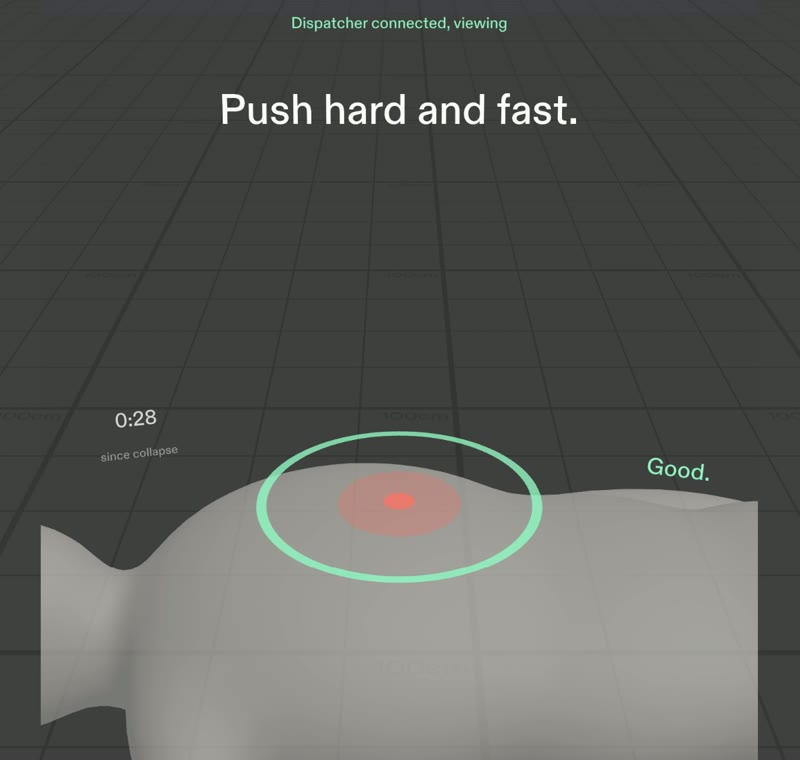
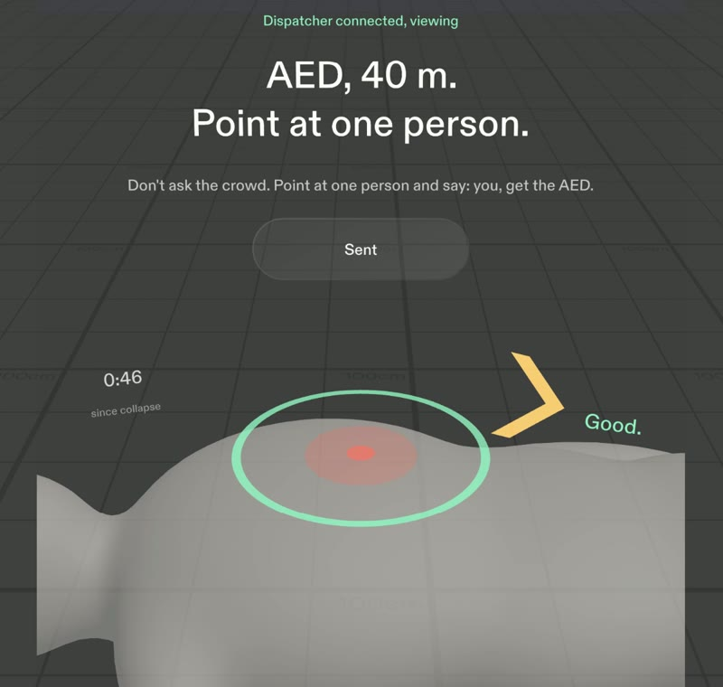
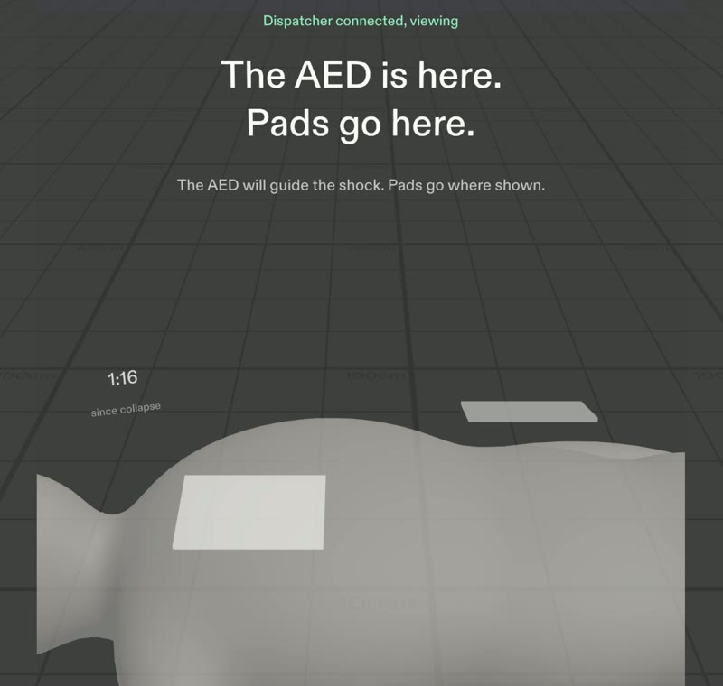
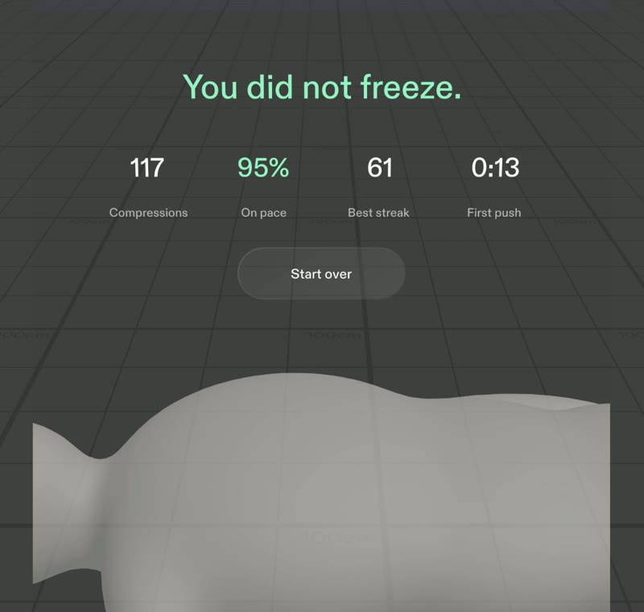
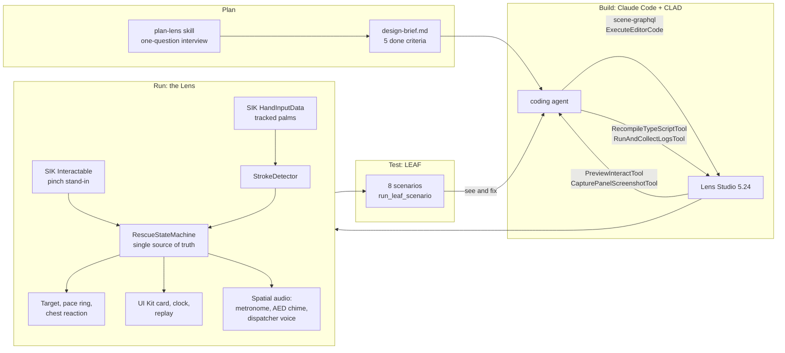

# Someone

**Be the someone who moves first.**

When someone collapses, most people freeze. Someone is a Snap SPECS Lens that guides you through CPR, hands-free, one calm step at a time, with 911 seeing what you see.

Built for the Devpost "Learn AR with SPECS" hackathon. Planned with the `plan-lens` skill, built by a coding agent through CLAD and the Lens Studio MCP, and checked with LEAF tests in the Lens Studio preview.

| | |
|---|---|
|  |  |
| **Push.** A target on the sternum at real size; the ring pulses at 110 a minute and turns mint on pace. | **Point at one person.** Never "send someone": a chime and a chevron lead to the AED. |
|  |  |
| **The AED.** Pads shown where they go, then "Stand clear." | **Replay.** *You did not freeze.* Then the evidence. |

All four frames are the Lens Studio preview, recorded live during the `demo-run-scenario` LEAF run.

---

## Who it's for

Ordinary people, trained or not, who would freeze in an emergency. That is most people.

- About 263,700 EMS-treated out-of-hospital cardiac arrests happen in the US each year, and only about 10.5% of patients survive to hospital discharge (CARES 2024, via the AHA 2025 Guidelines).
- Only about 42% of patients get bystander CPR (CARES 2025).
- Of CPR-trained bystanders who did not help, 37% said they simply panicked (Swor et al., *Academic Emergency Medicine*, 2006).
- The more people present, the less likely any one of them acts: the bystander effect (Darley and Latane, 1968). Everyone waits for "someone".

The barrier is not knowledge. It is the freeze. Existing AR CPR work focuses on technique feedback. Someone is designed for the first frozen seconds.

## Why glasses

CPR needs both hands and your eyes on the person. A phone has to be put down, and then it cannot guide you. Someone uses all three things glasses do that a phone cannot:

1. **Leaves your body free.** Both hands compress; your eyes stay on the person.
2. **Draws in the world.** The target sits on the chest at real size, where your hands go.
3. **Shares your view.** The dispatcher sees what you see.

## What it does

One spatial moment carries the Lens: you kneel by the person, a target glows on the center of the chest, and a ring around it pulses at 110 per minute with a soft beat coming from the chest. Every push is scored against the guideline rate of 100 to 120 per minute.

The flow, one instruction at a time:

1. "Someone collapsed." A thin coral ring on the ground marks the person from across the plaza, so you know where to go. Pinch **I see someone**.
2. "Tap their shoulder. Are they breathing?" Pinch **Not breathing**.
3. Pinch **Call 911**. A badge reads "Dispatcher connected, viewing", mint viewfinder corners flash once around your view (the dispatcher now sees what you see), and a calm scripted dispatcher speaks with captions.
4. "Push here." Put your hands on the chest and push. On glasses, hand tracking counts each push stroke (in the preview, a pinch on the target stands in for a push). The target brightens when your palms are on the chest, the chest gives a little under every push, and one ring travels out from your hands per push, colored by your pace. The floor ring fades away: now the chest holds the attention. The pace ring turns mint at 100 to 120 per minute and shows "Faster." or "Slower." when you drift.
5. At 1:30, a chime from the side and an amber chevron at the edge of view: "AED, 40 m. Point at one person." The dispatcher adds: "Don't ask the crowd. Point at one person and say: you, get the AED." A crowd asked to "send someone" waits; one named person moves. That is the bystander effect, designed against. Pinch **Sent**.
6. At 2:00: "Switch with a helper if you can." The ring hides until you pinch **Swapped**.
7. The AED arrives: pads show on the chest, "Stand clear.", the AED delivers a simulated shock, and you resume compressions.
8. "Help is here." A calm replay leads with one line, *You did not freeze.*, then four numbers that count up as it settles: compressions, % on pace, best streak and time to first push.

A small clock low in the left of the view shows time since collapse. Timed prompts that fire while another prompt is waiting queue behind it, so there is never more than one card. A demo-mode flag shortens the timers so the full run fits in a video.

## Stand-ins (what the preview cannot show)

- **The person** is a realistic, real-scale human figure on the floor (built from CC0 MakeHuman assets). Real glasses would need to recognize a real person and find the chest; the Lens assumes that recognition already happened and places the target on the sternum.
- **A compression** is counted from tracked hands on glasses (`SomeoneHandCompression` + `SomeoneStrokeDetector`: a 2 cm push counts, a 1.5 cm recoil re-arms). The preview mouse is one pinching hand, so a pinch on the target stands in for a push there. This path is logic proven (LEAF feeds synthetic strokes, and the preview's simulated palm drives it live) and feel unproven. Depth is never measured or claimed.
- **The 911 dispatcher** is scripted voice lines (Kokoro-82M text to speech) with captions. There is no real call and no real video share.
- **The AED, the helper and the shock** are scripted on timers.

## Design

Calm, clinical, the opposite of an alarm. The SPECS display is additive (black renders transparent), so there are no dark panels: light, luminous elements sit directly on the world.

- Four colors only: pulse coral `#FF5A4E` (ring and target), on-pace mint `#5CF2B5`, caution amber `#FFC24D`, warm white `#F7F5F2` text.
- One typeface, large, sentence case, short verbs ("Push here.", "Faster.").
- Slow 300 to 500 ms fades. The ring pulse is the only rhythmic motion; the push ripple fires once per push, never on a loop.
- Content sits 0.6 to 1.6 m away and below eye level, clustered around the chest. The card floats about 30 cm above the chest so hands and words share one glance.

## Architecture: how Snap's tools built and run Someone

- **Plan.** The `plan-lens` skill from the Devpost Learn pack turned the idea into an approved brief with five done criteria that the preview can check.
- **Build.** Claude Code with the CLAD plugin built the whole Lens through the Lens Studio MCP. Scene and asset edits went through `scene-graphql` and `ExecuteEditorCode`, which also imported the Blender-built human and set materials. Every code change was followed by `RecompileTypeScriptTool` and `RunAndCollectLogsTool`. `PreviewInteractTool` pressed buttons and moved a simulated palm, `MovePreviewCamera` stood where a user would, and `CapturePanelScreenshotTool` let the agent look at each beat and fix what it saw.
- **Run.** One pure-logic state machine drives everything. Spectacles Interaction Kit supplies tracked hands (palms on the chest feed a stroke detector) and the pinch stand-in. Spectacles UI Kit draws the card and buttons. Spatial audio places the metronome at the chest and the AED chime in the AED's direction.
- **Test.** Eight LEAF scenarios run in the preview with `run_leaf_scenario`: one per done criterion, plus hand-tracked strokes, the flow rules, and the whole rescue end to end, which also drove the demo video recording.

## How it was built

1. **Planned with `plan-lens`.** The skill interviewed the owner one question at a time and wrote [`devpost/design-brief.md`](devpost/design-brief.md) (status: approved) with five done criteria.
2. **Built by a coding agent through CLAD and the Lens Studio MCP.** Claude Code with the CLAD plugin wrote every TypeScript component, wired the scene, imported assets and drove the preview through the Lens Studio MCP in Lens Studio 5.24.1: `RecompileTypeScriptTool` and `RunAndCollectLogsTool` after every change, `ExecuteEditorCode` and `scene-graphql` for scene edits, `PreviewInteractTool` and `CapturePanelScreenshotTool` to walk each beat from the user's eye, and `run_leaf_scenario` for tests. The agent looked at every beat, found problems (a pace ring that rendered as a filled disc, a clock outside the 32 degree view, an AED arrow painted over by the figure, a replay clipped at the top, dispatcher lines cut mid-sentence) and fixed them in the loop.
3. **Tested with LEAF.** Eight LEAF scenarios in `Someone/Assets/Scripts/Tests/` drive real SIK pinches in the preview: one per done criterion, plus hand-tracked compressions, the flow rules, and the whole rescue end to end in demo mode (`DemoRunScenario.ts`, also used to record the demo video).
4. **Assets made by tools, from scripts.** The person is built in Blender from CC0 MakeHuman assets by `tools/blender/build_human.py` (with a `Compress` blend shape so the chest gives under each push), the pace ring and AED chevron are flat meshes built at runtime in centimetres, sound effects are synthesized (`tools/gen_sfx_someone.js`), and the dispatcher voice is generated with Kokoro-82M (`tools/kokoro/gen_dispatcher.mjs`).

| # | Done criterion | Scenario |
|---|---|---|
| 1 | Pinching the chest target starts compressions, and the pace ring appears centered on the chest | `DoneCriterion1Scenario.ts` |
| 2 | A steady 100 to 120 per minute turns the ring green; slower shows "Faster", quicker shows "Slower" | `DoneCriterion2Scenario.ts` |
| 3 | Only one instruction card is visible at any moment, from "I see someone" to the replay | `DoneCriterion3Scenario.ts` |
| 4 | At 1:30 (or the demo time) the AED arrow and chime appear; pinching "Sent" dismisses both | `DoneCriterion4Scenario.ts` |
| 5 | The replay shows the correct compression count and on-pace percentage | `DoneCriterion5Scenario.ts` |
| + | Hand-tracked pushes: a 5 cm stroke at 110 per minute counts each push and turns the ring green; a resting hand with tremor counts nothing (logic proven, feel unproven) | `HandCompressionScenario.ts` |
| + | Flow rules: dispatcher lines are never cut or stale; a timed prompt queues behind an unanswered one (still one card); the swap hides the ring and pauses scoring | `FlowRulesScenario.ts` |

Architecture: one pure-logic state machine (`SomeoneRescueStateMachine`) is the single source of truth. A compression tracker computes a rolling rate from the last five push intervals (pinches and tracked hands feed the same path), a session-stats module feeds the replay, and every visual is a passive view driven by state-machine events.

## How Someone meets the judging criteria

**Design: a complete, coherent product, not a proof of concept.** One story from collapse to replay, one instruction at a time (tested). Every element is attached to the task: target and ring on the sternum, the card 30 cm above the chest in the same glance as the hands, status small and low, the out-of-view AED reached by sound and an edge chevron. Your hands push; there is nothing to hold. Four colors, light on the world for an additive display, slow fades, and the ring pulse as the only rhythm. Everything sits inside the 32 by 37 degree Specs view at 0.6 to 1.6 m.

**Technical implementation: CLAD, Lens Studio and the MCP.** A pure-logic rescue state machine is the single source of truth, and every view is passive. Rolling-window rate scoring, a hand-tracking stroke detector with hysteresis, spatial audio from the chest and from the AED's direction, runtime meshes in real centimetres, and a dispatcher that never cuts or lags. Built and verified entirely by the agent through the Lens Studio MCP, with eight LEAF scenarios passing in the preview, one of them the whole rescue end to end.

**Innovation: designed for the freeze, not for technique.** Prior AR CPR work grades technique on a mannequin. Someone designs against panic (one calm instruction, a voice that is with you) and against the bystander effect (it never asks a crowd; it tells you to point at one person). It combines all three glasses pillars in one moment: hands free on the chest, guidance drawn on the body, and a dispatcher who sees your view.

**Presentation.** The problem, who it's for and why glasses come first; the whole rescue runs end to end in the preview; every stand-in is named.

## Run it

1. Open `Someone/Someone.esproj` in Lens Studio 5.24.1 or later.
2. In the Preview panel choose Interactive Preview. Click acts as a pinch; WASD moves, Q and E go down and up, right-drag looks around.
3. On `SomeoneExperience`, tick `demoMode` for the short timers.
4. Run the LEAF scenarios from the LEAF panel.

## Pre-existing assets and packages

- Spectacles Interaction Kit and Spectacles UI Kit (Snap).
- LEAF testing packages (Snap).
- Lens Studio SPECS Base Template.
- Person: MakeHuman base mesh, clothes, hair and eyes (CC0) through the MPFB 2 Blender add-on; posed, recolored (logo painted out) and given a chest blend shape by our script.
- Preview environment: Lens Studio's built-in Sunlit Outdoor interactive scene.
- Dispatcher voice: Kokoro-82M text to speech (Apache 2.0), voice `af_heart`, via `kokoro-js`.
- Everything else (scripts, meshes, materials, sound effects, copy) was made for this project during the submission period. Sound effects were synthesized locally (`tools/gen_sfx_someone.js`); the human is assembled by `tools/blender/build_human.py`.

## What we learned

- Designing for panic means taking things away. Every extra label we tried competed with the one instruction that mattered.
- On an additive display, "contrast" means light on the world, not text on a panel.
- A rolling rate over a few intervals is the right unit of feedback; a single click is too noisy to judge.
- The preview is honest about its limits. Naming each stand-in made the design clearer, not weaker.

## Medical note

Someone is a design concept and practice tool, not a medical device. CPR circulates blood; it does not restart a heart. Guidance aligns with the published rate of 100 to 120 per minute. Take a certified CPR and AED course.
