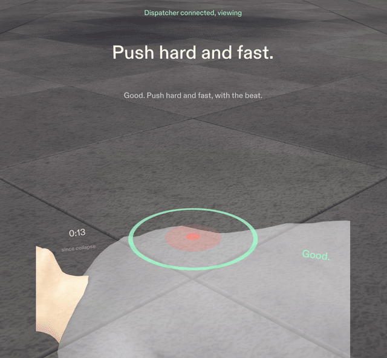
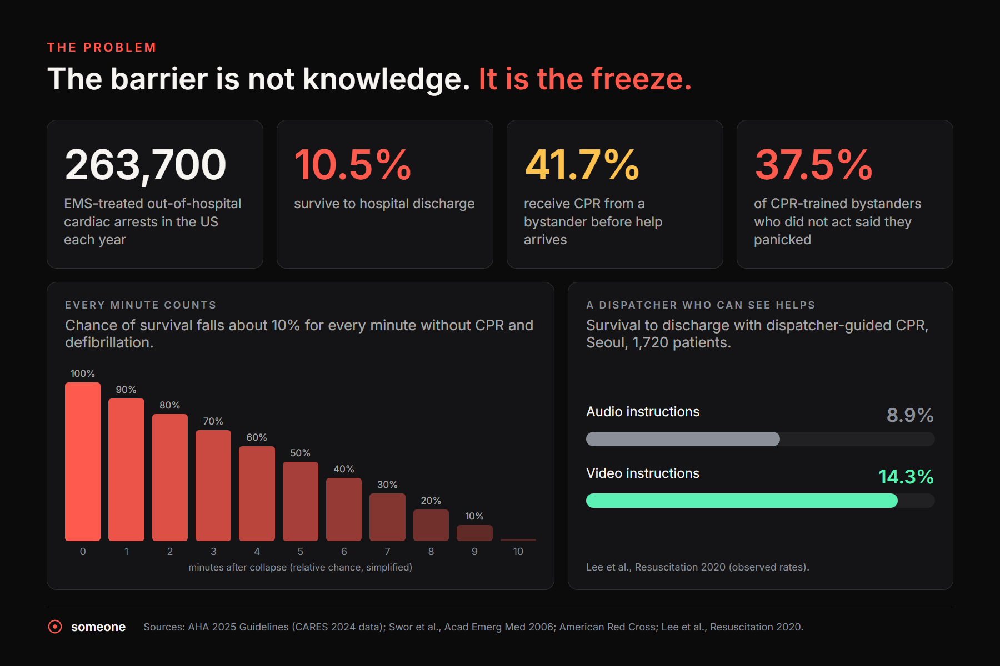
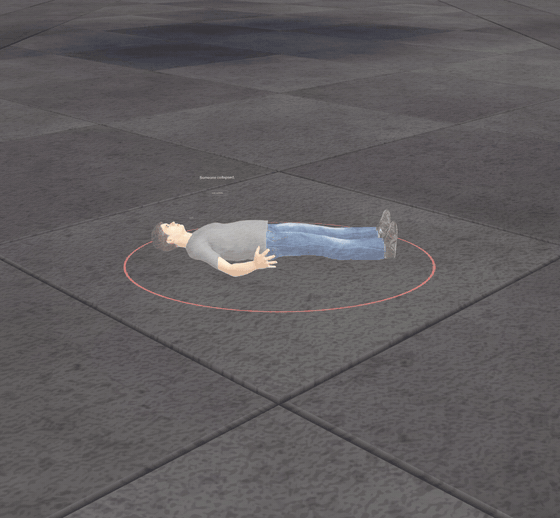
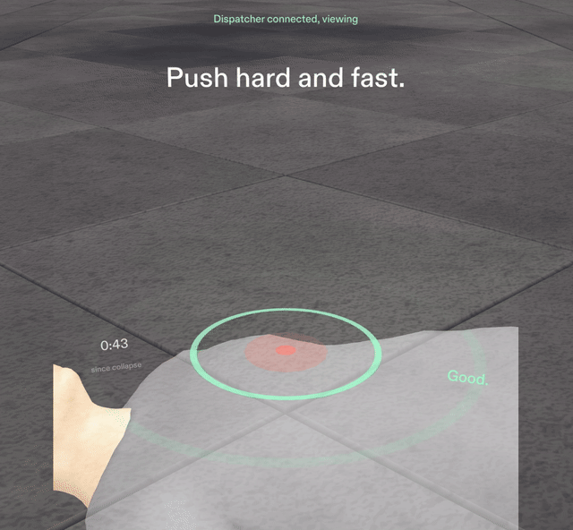
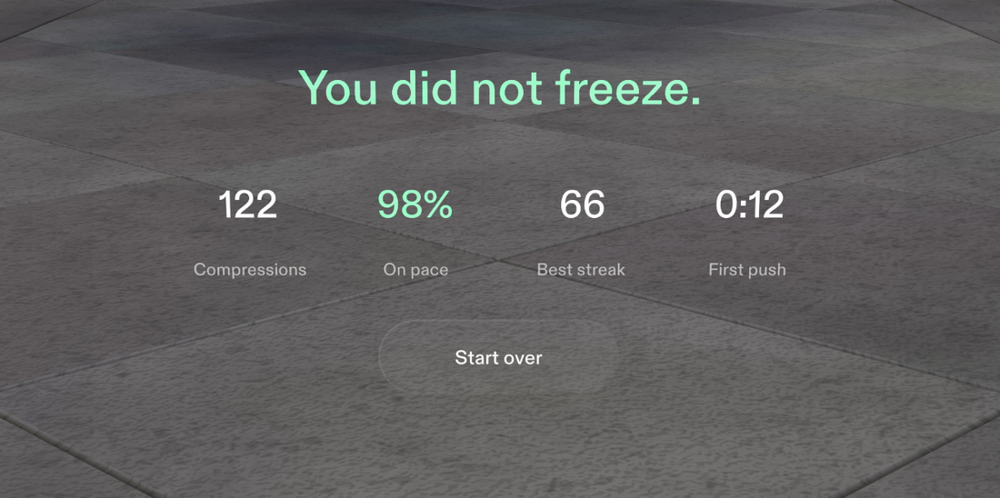
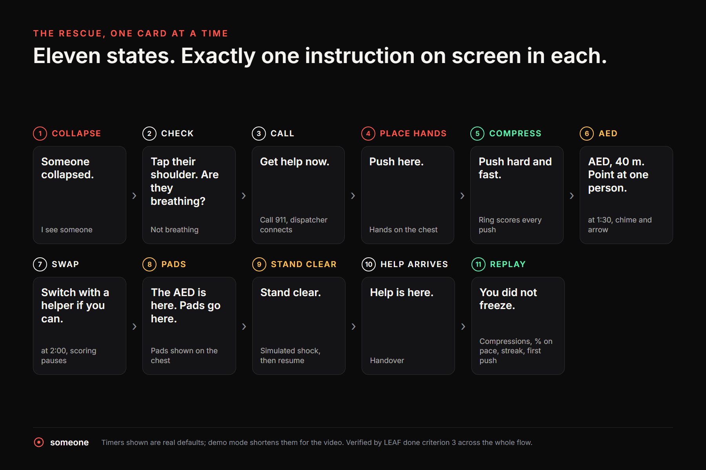
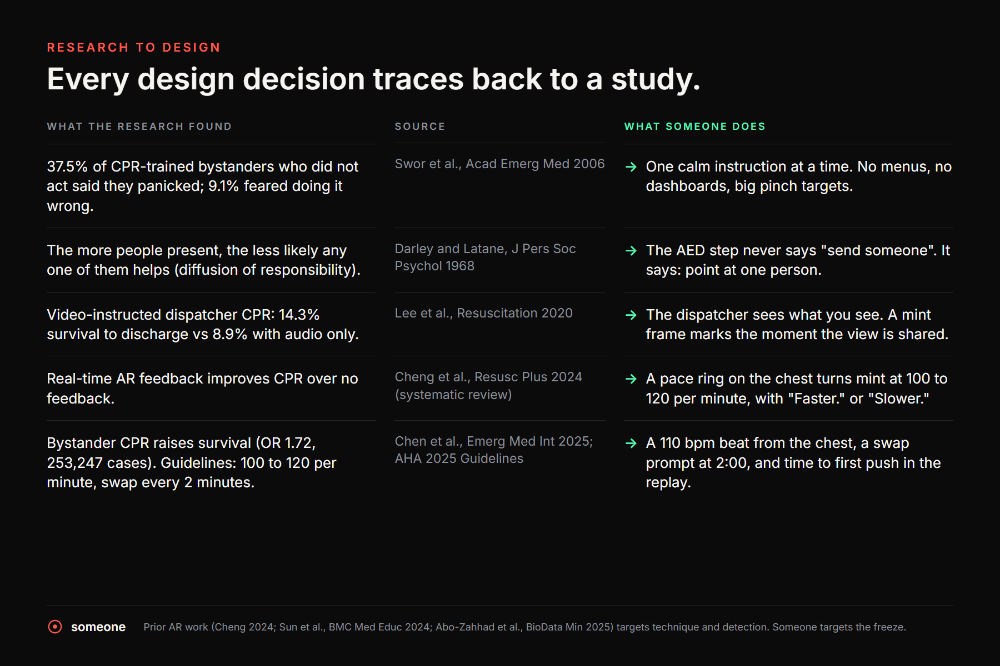
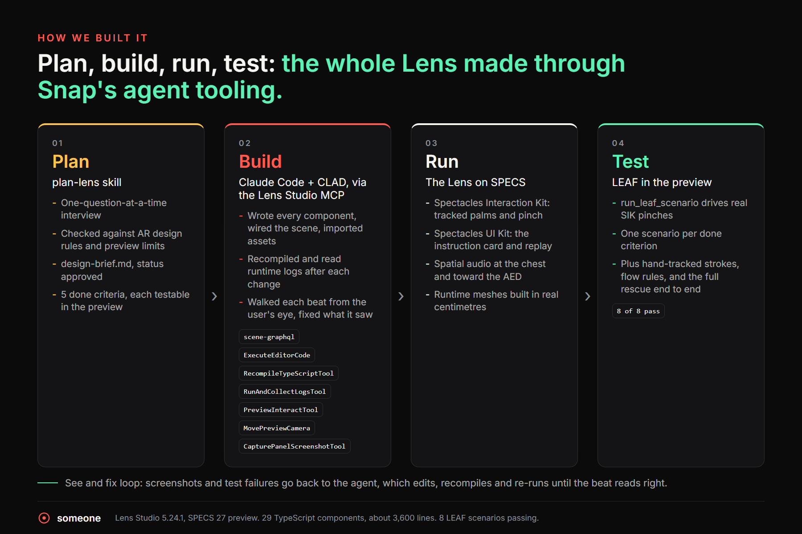
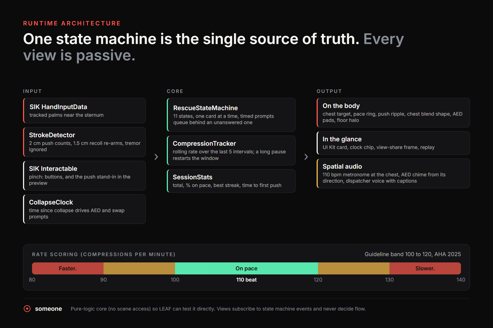

## Inspiration

**You are crossing a busy plaza. A man in front of you drops to the ground. Forty people stop. Forty people look at each other. Every one of them is waiting for someone.**

- **The clock has already started.** His chance of survival falls by about 10% for every minute without CPR and defibrillation, and help is still minutes away.
- **Knowing CPR is not enough.** In a study of 684 cardiac arrest bystanders, the most common reason CPR-trained people did not help was simple: **37.5% said they panicked** (Swor et al., 2006).
- **Crowds make it worse.** Darley and Latané (1968) showed that the more people who witness an emergency, the less likely any one of them is to step in. Responsibility spreads thin, and everyone waits for "someone".
- **So we asked a different question.** Not "how do we teach CPR?", but: *what if, in the exact second you freeze, a calm voice and a clear guide appeared right where your hands need to go?*

That is **Someone**: a Snap Specs Lens that turns a frozen bystander into **the someone who moves first**.

**Watch the 3-minute film:** [YouTube](https://www.youtube.com/watch?v=DGrxhbs6_Fk) · **Source, tests and docs:** [GitHub](https://github.com/ahammadshawki8/Someone)

## What it does

Someone guides you through a cardiac arrest **hands-free, one calm instruction at a time**, with the guide drawn on the person's body instead of on a screen.

- **Who it's for:** ordinary people, trained or not, who would freeze in an emergency. That is most of us.
- **What it is:** a design concept and practice tool aligned with AHA guidelines (100 to 120 compressions per minute). It guides; it is not a medical device.

- **Seen from afar.** A thin coral ring on the ground marks the person from across the plaza, so you know where to go. It fades once your hands are on the chest.
- **Check and call.** "Tap their shoulder. Are they breathing?" Then one large **Call 911** button.
- **The dispatcher sees what you see.** When the dispatcher connects, mint corners flash around your view to show your view is now shared, and a calm voice coaches you, with captions for every line.
- **The core moment: compressions on the chest.**
  - A glowing target sits on the sternum at real size.
  - A pace ring pulses at **110 beats per minute**, with a soft metronome that plays *from the chest itself* (spatial audio).
  - Every push is scored live: the ring turns **mint between 100 and 120 per minute** and says "Faster." or "Slower." when you drift.
  - The chest gives a little under each push, and one ring ripples out from your hands, coloured by your pace.
- **AED wayfinding, designed against the bystander effect.** At 1:30, a chime sounds from the side and an amber chevron points out of view: **"AED, 40 m. Point at one person."** The dispatcher adds: *"Don't ask the crowd. Point at one person and say: you, get the AED."* A crowd asked to "send someone" waits. One named person moves.

- **Rescuer swap.** At 2:00: "Switch with a helper if you can." Guidelines recommend swapping about every two minutes, so scoring pauses during the handoff.
- **The AED arrives.** Pads appear on the chest, "Stand clear.", the AED delivers its shock, then you resume compressions.
- **Replay.** When help arrives, one line comes first: ***You did not freeze.*** Then four numbers count up: compressions, % on pace, best streak, and time to first push.

## Design

Design comes first in this project, because in a panic, design is the product. Every rule below follows Snap's spatial design guidelines for Specs.

- **One instruction at a time.** Panic shrinks attention, so only one card is ever on screen. A LEAF test checks this across the whole rescue.
- **Information sits on the thing it describes.** The target and ring are on the sternum. The card floats about 30 cm above the chest, so your words and your hands share one glance.
- **Show it only when it's needed.** The floor ring disappears once you start. The AED arrow appears at 1:30 and leaves once you've acted. Nothing waits on screen "just in case".
- **Few, large targets and simple gestures.** One big button per step. During CPR your hands do the work; you never pinch mid-compression.
- **Status near the task, sound for what's out of view.** The clock is small and low in the view, never in the centre. The AED is behind you, so it gets a directional chime and an edge arrow instead of another panel.
- **Comfortable to use.** Every element sits 0.6 to 1.6 m away, slightly below eye level, inside the 32 by 37 degree Specs view.
- **Made for an additive display.** Black renders transparent on Specs, so there are no dark panels: light, luminous elements sit directly on the world.
- **A restrained visual language.**
  - **Four colours, each with one meaning:** coral `#FF5A4E` for the pulse, mint `#5CF2B5` for on pace, amber `#FFC24D` for caution, warm white `#F7F5F2` for text.
  - **Type:** one clean typeface in sentence case, with short verbs: "Push here.", "Faster."
  - **Motion:** slow 300 to 500 ms fades. The pace ring is the only thing that pulses.

## Why it belongs on glasses

- **It leaves your body free.** CPR takes both hands and your eyes on the person. A phone has to be set down, and then it can't guide you.
- **It draws in the world.** The guide sits on the chest, exactly where your hands go, at real size.
- **It shares your view.** The dispatcher sees through your eyes instead of asking you to describe a scene you can barely process.
- **All three strengths of Specs in a single moment.** A phone or laptop version cannot do this.

## Backed by research

Every design decision in Someone traces back to a published finding.

- **Panic is the barrier** (Swor 2006). So: **one instruction at a time**.
- **Crowds spread responsibility thin** (Darley and Latané 1968). So: **point at one person**, never "send someone".
- **Video-guided dispatch is linked to higher survival:** 14.3% vs 8.9% with audio alone (Lee 2020). So: **the dispatcher sees your view**.
- **Real-time AR feedback improves CPR** over no feedback (Cheng 2024). So: **a pace ring that scores every push**.
- **Survival depends on how fast CPR starts:** bystander CPR gives an OR of 1.72 across 253,247 arrests (Chen 2025). So: **the replay measures time to first push**.
- **Where we fit:** existing AR CPR work trains technique or detects injuries (Cheng 2024, Sun 2024, Abo-Zahhad 2025). We found no work that designs for **the freeze itself**. That is the gap Someone fills.

## How we built it

We built Someone the way this hackathon is meant to be built: **planned with plan-lens, built by an agent through CLAD and the Lens Studio MCP, and verified with LEAF tests in the preview.**

- **Our team made the decisions; the agent did the building.** We set:
  - the panic-first framing and the research behind it;
  - the "point at one person" line;
  - the design rules;
  - the five done criteria;
  - the human figure.

  Claude Code with CLAD turned those into a working Lens, and we reviewed every beat.
- **Plan: the plan-lens skill.** A one-question-at-a-time interview checked the idea against AR design rules and preview limits, and produced an approved design brief with **five done criteria**, each testable in the preview.
- **Build: Claude Code with CLAD, through the Lens Studio MCP (Lens Studio 5.24.1).**
  - **29 TypeScript components, about 3,600 lines.**
  - **Scene edits** went through `scene-graphql` and `ExecuteEditorCode`.
  - **After every change,** `RecompileTypeScriptTool` and `RunAndCollectLogsTool`.
  - **Every beat walked from the user's eye** with `PreviewInteractTool`, `MovePreviewCamera` and `CapturePanelScreenshotTool`, then fixed in a see-and-fix loop.
- **Run: the Lens on Specs.**
  - **Spectacles Interaction Kit:** tracked palms for compressions, pinch for buttons.
  - **Spectacles UI Kit:** the instruction card and the replay.
  - **Spatial audio:** the metronome at the chest, the AED chime from its direction.
  - **Runtime meshes in real centimetres:** the ring, chevron, viewfinder and ripples.
- **Test: LEAF.** **Eight scenarios pass** in the preview: one per done criterion, plus hand-tracked strokes, the flow rules, and the full rescue end to end. That same end-to-end scenario recorded the footage in our film, so what you see is the real Lens running.

- **One source of truth.** A pure-logic `RescueStateMachine` (11 states) drives every view. Views are passive and never decide the flow, so the logic is directly testable.
- **Real rhythm scoring.** `CompressionTracker` computes a rolling rate over the last 5 push intervals, so one uneven push never flips the feedback. A long pause restarts the window.
- **Hand-tracked compressions.** `StrokeDetector` reads both tracked palms near the sternum. A 2 cm push counts and a 1.5 cm recoil re-arms it (hysteresis), so a resting or trembling hand never counts. Depth is never claimed.
- **A prompt queue.** Timed prompts (AED at 1:30, swap at 2:00) that fire while you still owe an answer wait in line, so **there is never more than one card on screen**.
- **Built for hardware, proven in the preview.** Every input sits behind a clean interface, so moving to real Specs means connecting real inputs, not rewriting the Lens:
  - **Compressions:** tracked palms on glasses; in the preview, a pinch on the target drives the same scoring path.
  - **The person:** recognition hands the Lens a chest position; in the preview, a real-scale human figure provides it.
  - **The dispatcher:** today a scripted voice with captions; real video-assisted dispatch connects to the same event.
- **Assets made by us, from scripts.**
  - **The person:** built in Blender from CC0 MakeHuman assets, with a `Compress` blend shape so the chest gives under each push.
  - **The dispatcher voice:** Kokoro-82M text to speech (Apache 2.0).
  - **Sound effects:** synthesized locally.

## Challenges we ran into

- **Designing for an additive display.** Without dark panels, every bit of readability had to come from light text and luminous shapes over the real world, in four colours only.
- **A ring that rendered as a filled disc.** The first pace ring was a torus primitive that showed up as a solid 26 cm coral blob over the target. We replaced it with a runtime flat ring (0.8 cm line, 11 cm radius).
- **A dispatcher that keeps up.** Queued voice lines were cut mid-sentence, then read after the moment had passed. Now each line finishes, and only the newest waiting line is spoken.
- **Timers vs pinches.** The AED and swap prompts run on the clock but must never stack. A small queue in the state machine solved it, and a LEAF test guards it.
- **Fitting the Specs view.** We moved the clock out of the centre and lowered the replay so its headline stays in view, keeping everything inside the 32 by 37 degree view.
- **Restraint.** We built extra effects (a floor perimeter, holographic hands, constantly pulsing markers) and cut them, because each one competed with the single instruction that matters. Everything that stayed has a job.

## Accomplishments that we're proud of

- **A complete rescue**, from collapse to replay, that never shows more than one instruction, with a test that proves it.
- **8 of 8 LEAF scenarios passing**, covering every done criterion and more.
- **One sentence of UI copy that carries the product's insight:** "Point at one person."
- **A person who reacts:** the chest gives under every push.
- **A calm, premium visual language** that reads on an additive display.

## What we learned

- **Designing for panic means taking things away.** Every extra label we tried competed with the one instruction that mattered.
- **On an additive display, contrast means light on the world**, not text on a panel.
- **A rolling rate is the right unit of feedback.** A single interval is too noisy to judge a human rhythm.
- **Agent-built and verified go together.** Pairing CLAD with screenshots and LEAF tests turned "it compiles" into "it works, and here is the proof".
- **Research is a design tool.** Reading the bystander literature changed one sentence in our UI, and that sentence became the heart of the product.

## What's next for Someone

- **From preview to people.** We will install Someone on real Specs and test it with everyday users, CPR instructors and emergency dispatchers.
- **Tuned on real hands.** We will calibrate hand-tracked compressions against real hands on a training manikin.
- **Partnering with the people who answer the call.** We will work with dispatch centres to connect the shared view to real video-assisted dispatch.
- **Live for every Specs user.** We will publish Someone so it is on every pair of Specs, ready for the one moment it matters. As glasses become all-day devices, a guide like this should be there before anyone needs it.
- **Idea to reality.** One day, when someone collapses on a busy street, the person wearing Specs will not freeze. They will be the someone who moves first.

## Why Someone should win

- **Design:** a complete, coherent product, not a tech demo. One story, one instruction at a time, information on the body, sound for what's out of view, and a calm visual language built for an additive display.
- **Technical:** built end to end with plan-lens, CLAD and the Lens Studio MCP. It has:
  - a clean state machine;
  - rolling rhythm scoring;
  - hand-tracking with hysteresis;
  - spatial audio;
  - real-scale runtime meshes;
  - **8 of 8 LEAF tests passing**.
- **Innovation:** other AR CPR projects train technique. Someone designs against **panic** and the **bystander effect**, and uses all three strengths of glasses in one moment.
- **Presentation:**
  - every claim is backed by a cited study;
  - every system is shown in a diagram;
  - the film shows the real Lens running end to end, from the first step across the plaza to "You did not freeze."

**In a crowd, everyone waits. Be the someone who moves first.**

**Try it yourself:** open `Someone/Someone.esproj` in Lens Studio 5.24 or later from our [GitHub repo](https://github.com/ahammadshawki8/Someone), choose Interactive Preview, and run the eight LEAF scenarios from the LEAF panel. **Watch the film:** [youtube.com/watch?v=DGrxhbs6_Fk](https://www.youtube.com/watch?v=DGrxhbs6_Fk)

## References

1. Swor R, Khan I, Domeier R, Honeycutt L, Chu K, Compton S. CPR training and CPR performance: do CPR-trained bystanders perform CPR? *Acad Emerg Med.* 2006;13(6):596-601. doi:10.1197/j.aem.2005.12.021
2. Darley JM, Latané B. Bystander intervention in emergencies: diffusion of responsibility. *J Pers Soc Psychol.* 1968;8(4):377-383. doi:10.1037/h0025589
3. Lee SY, Song KJ, Shin SD, et al. Comparison of the effects of audio-instructed and video-instructed dispatcher-assisted cardiopulmonary resuscitation on resuscitation outcomes after out-of-hospital cardiac arrest. *Resuscitation.* 2020. doi:10.1016/j.resuscitation.2019.12.004
4. Cheng A, Fijacko N, Lockey A, et al. Use of augmented and virtual reality in resuscitation training: a systematic review. *Resusc Plus.* 2024. doi:10.1016/j.resplu.2024.100643
5. Chen X, Zou Z, Wen X, Li L, Liang Y. The role of bystander cardiopulmonary resuscitation: a meta-analysis. *Emerg Med Int.* 2025. doi:10.1155/emmi/5591055
6. Sun R, Wang Y, Wu Q, et al. Effectiveness of virtual and augmented reality for cardiopulmonary resuscitation training: a systematic review and meta-analysis. *BMC Med Educ.* 2024. doi:10.1186/s12909-024-05720-8
7. Abo-Zahhad M, et al. Development of an AI-powered AR glasses system for real-time first aid guidance in emergency situations. *BioData Min.* 2025. doi:10.1186/s13040-025-00473-6
8. American Heart Association. 2025 Guidelines for CPR and Emergency Cardiovascular Care (CARES 2024 data: about 263,700 EMS-treated cardiac arrests, 10.5% survival to discharge, 41.7% bystander CPR). https://cpr.heart.org/en/resuscitation-science/cpr-and-ecc-guidelines
9. American Red Cross. CPR facts and statistics. https://www.redcross.org/take-a-class/resources/articles/cpr-facts-and-statistics
10. Snap Inc. Introduction to spatial design for Spectacles. https://developers.snap.com/spectacles/best-practices/design-for-spectacles/introduction-to-spatial-design
